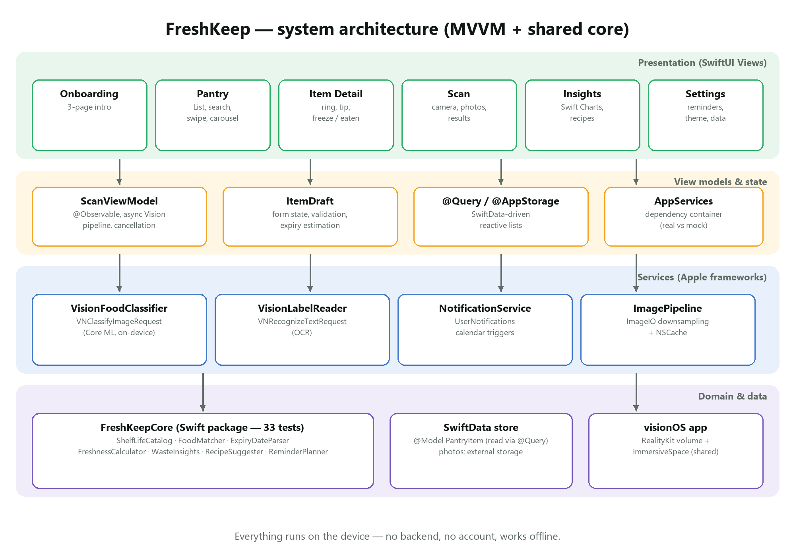
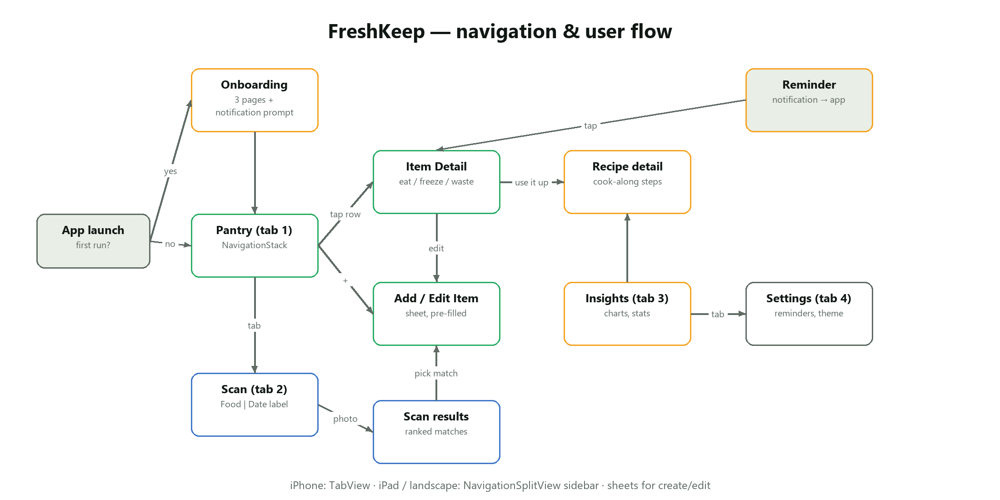

# FreshKeep — Technical Documentation

## 1. Overview

FreshKeep is a SwiftUI app for iOS 17+ (iPhone and iPad) plus a visionOS prototype. All logic
runs on the device: there is no backend and no account.

| Item | Value |
|---|---|
| Language | Swift (Swift 5 language mode, builds with Xcode 16 / 26) |
| UI | SwiftUI, Observation (`@Observable`), Swift Charts, PhotosUI |
| Persistence | SwiftData (`@Model PantryItem`), `@AppStorage` for settings |
| ML | Vision: `VNClassifyImageRequest` (Core ML image classifier), `VNRecognizeTextRequest` (OCR) |
| Notifications | UserNotifications with calendar triggers |
| visionOS | RealityKit `RealityView`, volumetric `WindowGroup`, `ImmersiveSpace`, ornaments |
| Project | XcodeGen (`project.yml`) → `FreshKeep.xcodeproj` |
| CI | GitHub Actions, macOS runners (`.github/workflows/ios.yml`) |

## 2. Architecture



The app follows **MVVM with services**:

* **Views** (`FreshKeep/Views`) are small SwiftUI structs. Lists read SwiftData directly with
  `@Query`, which keeps them reactive without boilerplate.
* **View models / state** — `ScanViewModel` (`@Observable`, main-actor) owns the scan pipeline:
  downsampling, running Vision off the main thread, cancellation when a new photo arrives, and the
  `Phase` state machine (`idle → analyzing → foods | noFood | label | failed`).
  `ItemDraft` is a value-type form model so cancelling a sheet never touches the store.
* **Services** (`FreshKeep/Services`) wrap Apple frameworks behind protocols
  (`FoodClassifying`, `LabelReading`, `NotificationScheduling`). `AppServices` is injected through
  the SwiftUI environment and swaps in deterministic mocks for UI tests (`-mock-classifier`).
* **FreshKeepCore** (`Packages/FreshKeepCore`) is a Swift package with no UI dependencies. It is
  shared by the iOS and visionOS targets and tested on any platform with `swift test`.

### 2.1 Module responsibilities

| Type | Responsibility |
|---|---|
| `ShelfLifeCatalog` | 48 foods: aliases, shelf life per storage location, storage tip, typical LKR price. Normalises classifier labels (`granny_smith` → "granny smith"), handles plurals, prefix search. |
| `FoodMatcher` | Filters Vision labels to foods, merges synonyms, keeps highest confidence per food, falls back to a category ("fruit") when no specific food is found. |
| `ExpiryDateParser` | Regex-based parser for day-first numeric dates, ISO dates, month names, month/year-only dates (→ end of month). Chooses the date after an expiry keyword over MFD dates; rejects impossible dates. |
| `FreshnessCalculator` | Days left, level (expired / today / use soon / fresh) and remaining fraction for the ring. |
| `WasteInsights` | Totals, rescue rate, money saved/wasted, CO₂e estimate, weekly buckets, zero-waste streak. |
| `RecipeSuggester` | Scores recipes: `2 × Σ 1/(daysLeft+1)` for owned ingredients + coverage ratio. |
| `ReminderPlanner` | "Use soon" and "expires today" fire dates at a configurable hour, dropping past dates. |

### 2.2 Data model

```swift
@Model final class PantryItem {
    @Attribute(.unique) var id: UUID
    var name: String
    var catalogID: String?          // link to ShelfLifeCatalog
    var categoryRaw: String         // FoodCategory
    var storageRaw: String          // StorageLocation
    var quantity: Int
    var addedAt: Date
    var expiresAt: Date
    var price: Double               // LKR per unit
    var notes: String
    @Attribute(.externalStorage) var photoData: Data?
    var statusRaw: String           // active | eaten | wasted
    var resolvedAt: Date?           // when eaten/wasted, drives charts
    var expirySourceRaw: String     // estimated | label | manual
}
```

Enums are stored as raw strings because `#Predicate` cannot use computed properties; typed
accessors (`category`, `storage`, `status`) wrap them. Photos use external storage so list
fetches stay small. Eaten/wasted items are kept (not deleted) to power the Insights screen.

### 2.3 Navigation

* iPhone (compact width): `TabView` with Pantry, Scan, Insights, Settings.
* iPad / large landscape (regular width): `NavigationSplitView` with the same sections in a sidebar.
* Each section owns a `NavigationStack`. Pantry uses value-based navigation
  (`NavigationLink(value:)` + `.navigationDestination(for: PantryItem.self)`), Insights navigates to
  `RecipeSuggestion` values. Create/edit flows are sheets; onboarding is a full-screen cover.



## 3. Emerging technology: Vision / Core ML

```
UIImage ──► downsample (≤1280 px) ──► VNImageRequestHandler
              │                          ├─ VNClassifyImageRequest ──► [label, confidence]
              │                          │       └─► FoodMatcher ──► ranked FoodMatch list
              │                          └─ VNRecognizeTextRequest ──► recognised lines
              │                                  └─► ExpiryDateParser ──► Date?
              └─ stored copy (≤1024 px JPEG, external storage)
```

* Requests run in `Task.detached(priority: .userInitiated)` so the UI stays at 60/120 fps.
* On the Simulator `usesCPUOnly` is set because there is no Neural Engine.
* Observations are filtered with `hasMinimumPrecision(0.1, forRecall: 0.8)` or confidence > 0.2.
* OCR uses `.accurate` recognition with language correction **off** (it "corrects" `12.11.26`
  into words otherwise).

## 4. UI implementation highlights

| Requirement | Implementation |
|---|---|
| Custom component | `FreshnessRing` — trimmed circle, gradient stroke, animated on appear/change, `@ScaledMetric`, VoiceOver value. |
| Custom modifier | `FreshCardModifier` (`.freshCard()`), `ShakeEffect` (GeometryEffect for invalid input). |
| Custom styles | `PrimaryButtonStyle`, `SoftButtonStyle` (spring scale on press), `FilterChip`. |
| Custom shape | `ViewfinderShape` (corner brackets) + animated `ScanningOverlay`. |
| Animations | keyframe confetti (`keyframeAnimator`), `phaseAnimator` floating emoji, `symbolEffect`, `scrollTransition` 3D carousel, `contentTransition(.numericText())`, animated charts. |
| Gestures | swipe actions, long-press context menu with preview, `MagnifyGesture` pinch-zoom, visionOS spatial tap + drag. |
| Adaptive layout | `NavigationSplitView` vs `TabView`, `ViewThatFits` (detail cards), `AnyLayout` HStack/VStack (scan screen), adaptive `LazyVGrid`. |
| Feedback | `sensoryFeedback` haptics, toasts with VoiceOver announcements. |
| Accessibility | Dynamic Type everywhere (system text styles), `@ScaledMetric`, combined accessibility elements, labels/hints, reduce-motion checks, colour + text for status (never colour alone). |
| Dark Mode | Every colour is an asset with a dark variant; shadows removed in dark mode. |

## 5. Performance and memory

* **Image downsampling with ImageIO** (`CGImageSourceCreateThumbnailAtIndex`) — a 12 MP photo is
  never decoded at full size. Stored photos are ≤1024 px JPEG (~150 KB instead of ~48 MB decoded).
* **Thumbnail cache** — `NSCache` (150 entries) keyed by item id and size.
* **External storage** for photos keeps SwiftData fetches fast; `@Query` uses a predicate and
  sort descriptor so filtering happens in SQLite.
* **Vision off the main actor**, with cancellation of stale scans.
* **Lazy containers** (`LazyHStack`, `LazyVGrid`) and value types for derived data.
* Measured in tests: catalog lookups (`measure`), 500-item fetch, app launch (`XCTApplicationLaunchMetric`).

## 6. Testing

| Suite | Count | Covers |
|---|---|---|
| `FreshKeepCoreTests` | 33 | parser formats & edge cases, matcher, catalog, freshness, insights, recipes, reminders, performance |
| `FreshKeepTests` | 19 | SwiftData queries, resolve/freeze, record maths, sample data, item draft logic, scan view model (mock services), image pipeline, fetch performance |
| `FreshKeepUITests` | 10 | onboarding, pantry + detail, add item, validation, scan → add, label scan, mark eaten, insights/settings, dark mode + accessibility text size, launch performance |

Run locally (`swift test`, ⌘U in Xcode) or let CI run them on every push. CI exports UI-test
screenshots and a screen recording as build artifacts.

## 7. Build, run and CI

```bash
brew install xcodegen
xcodegen generate
open FreshKeep.xcodeproj         # schemes: FreshKeep (iOS), FreshKeepSpatial (visionOS)
```

Launch arguments (used by UI tests and demos): `-ui-testing` (in-memory store),
`-skip-onboarding`, `-seed-sample-data`, `-mock-classifier`, `-appearance dark`.

CI jobs: `core` (swift test), `ios` (xcodegen → xcodebuild test on the newest iPhone simulator,
screen recording, screenshots, coverage), `visionos` (build for visionOS simulator, launch,
screenshot, recording).

## 8. Privacy and security

No network calls, analytics or accounts. Camera and photo access are requested with clear usage
descriptions. Data lives in the app sandbox and can be erased from Settings.

## 9. Known limitations / future work

* Apple's generic classifier recognises common produce well but not every packaged product;
  a custom Create ML model trained on local foods (e.g. jackfruit, gotukola) would improve accuracy.
* Barcode lookup (VisionKit `DataScannerViewController`) for packaged goods.
* iCloud sync (SwiftData + CloudKit) and a shared household pantry.
* Widgets / Live Activities for "use today" items.
